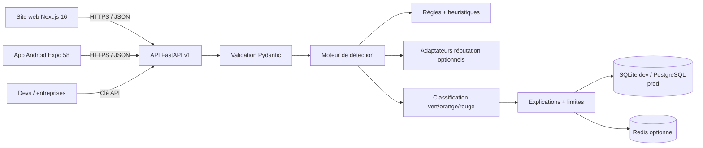

# Architecture définitive — SAFECLICK

## 1. Vue d'ensemble



Principe central : **les clients ne font jamais confiance au résultat sans explication**, et **le serveur ne fait jamais confiance à une entrée utilisateur**.

## 2. Couches

| Couche | Responsabilité | Technologie |
|---|---|---|
| Présentation web | Pages publiques, dashboard, admin, analyse | Next.js 16 App Router, React 19.3.0, TypeScript 5.9.3, Tailwind 4, shadcn/ui, Lucide |
| Présentation mobile | Analyse rapide, historique, notifications | Expo 58, React Native 0.88, React 19.3.0, TypeScript 6.0.3 |
| Contrats | Types partagés, niveaux de risque, limites | `packages/shared` |
| API | Routes versionnées, auth, quotas, erreurs, logs | FastAPI 0.165, Pydantic 2.14 |
| Métier | Détecteurs URL/messages, scoring, explication | Python pur + scikit-learn en phase 7 |
| Données | Utilisateurs, analyses, signalements, rôles, clés API | SQLAlchemy 2.1 + Alembic 1.20 |
| Infrastructure | Containers, CI, déploiement | Docker Compose (fourni), GitHub Actions (phase 10) |

## 3. Arborescence cible complète

```text
SAFECLICK/
├── apps/
│   ├── web/
│   │   ├── app/
│   │   │   ├── (public)/              # accueil, présentation, tarification, docs, aide, FAQ, contact
│   │   │   ├── (auth)/                # connexion, inscription
│   │   │   ├── dashboard/             # statistiques, historique
│   │   │   ├── analyze/               # url, message, résultat
│   │   │   ├── admin/                 # utilisateurs, signalements, quotas, clés API
│   │   │   ├── legal/                 # confidentialité, CGU
│   │   │   ├── api/docs/              # documentation API
│   │   │   ├── layout.tsx
│   │   │   └── globals.css
│   │   ├── components/
│   │   │   ├── ui/                    # shadcn/ui (généré et versionné)
│   │   │   ├── analysis/              # RiskBadge, IndicatorList, ResultCard
│   │   │   └── layout/                # Header, Footer, Sidebar
│   │   ├── lib/
│   │   │   ├── api-client.ts
│   │   │   ├── i18n/                  # FR par défaut, structure prête pour EN
│   │   │   └── utils.ts
│   │   ├── package.json
│   │   ├── tsconfig.json
│   │   └── next.config.ts
│   │
│   ├── mobile/
│   │   ├── app/                       # routeurs expo-router
│   │   │   ├── (auth)/
│   │   │   ├── (tabs)/
│   │   │   └── analyze/
│   │   ├── components/
│   │   ├── services/api.ts
│   │   ├── constants/theme.ts
│   │   ├── App.tsx
│   │   ├── app.json
│   │   ├── tsconfig.json
│   │   └── package.json
│   │
│   ├── services/api/
│   │   ├── app/
│   │   │   ├── api/
│   │   │   │   ├── deps.py            # injection DB, auth, quotas
│   │   │   │   ├── errors.py          # réponses d'erreur uniformes
│   │   │   │   └── routes/
│   │   │   │       ├── health.py
│   │   │   │       ├── analyze.py
│   │   │   │       ├── reports.py
│   │   │   │       ├── history.py
│   │   │   │       ├── users.py
│   │   │   │       ├── stats.py
│   │   │   │       └── admin.py
│   │   │   ├── core/
│   │   │   │   ├── config.py          # pydantic-settings, .env uniquement
│   │   │   │   ├── security.py        # Argon2, JWT, permissions
│   │   │   │   ├── rate_limit.py
│   │   │   │   └── logging.py
│   │   │   ├── models/                # SQLAlchemy ORM
│   │   │   ├── schemas/               # Pydantic request/response
│   │   │   ├── services/              # orchestration métier
│   │   │   ├── detectors/
│   │   │   │   ├── url.py             # analyse passive de la chaîne
│   │   │   │   ├── message.py
│   │   │   │   ├── indicators.py
│   │   │   │   └── scoring.py
│   │   │   ├── workers/               # tâches futures (réputation, redirections sécurisées)
│   │   │   ├── db/
│   │   │   │   ├── base.py
│   │   │   │   └── session.py
│   │   │   └── main.py
│   │   ├── alembic/
│   │   ├── tests/
│   │   │   ├── test_health.py
│   │   │   ├── test_url_detector.py
│   │   │   ├── test_message_detector.py
│   │   │   └── test_auth.py
│   │   ├── requirements.txt
│   │   ├── requirements-dev.txt
│   │   └── pyproject.toml
│   │
│   ├── packages/shared/src/index.ts
│   ├── infrastructure/
│   ├── docs/
│   ├── .env.example
│   ├── .gitignore
│   ├── .editorconfig
│   ├── docker-compose.yml
│   ├── package.json
│   └── README.md
```

> Choix volontaire : l'API Python est un service autonome et **non** un workspace npm. Les scripts npm à la racine l'invoquent via `python -m uvicorn ... --app-dir services/api`.

## 4. Flux d'une analyse

1. **Réception** : `POST /api/v1/analyze/url` ou `/analyze/message`.
2. **Validation** : longueur max (URL 2048, message 4000), type, normalisation contrôlée. Rejet immédiat des entrées vides ou invalides (422).
3. **Quota / rate limit** : clé API ou token utilisateur, compteur par minute et par plan.
4. **Détection** :
   - URL : schéma, host trop long, punycode, homoglyphes, `sub.domain.brand.tld` suspect, raccourcisseurs connus, caractères de confusion, correspondance de marques.
   - Message : règles regex explicites (urgence, argent, code, mot de passe, recrutement, usurpation), pondération, contexte.
5. **Réputation** : adaptateurs désactivés par défaut ; aucune donnée inventée si aucune clé.
6. **Scoring** : score indicatif 0-100, seuils documentés, jamais présenté comme probabilité validée.
7. **Explication** : indicateurs avec `code`, `label`, `detail`, recommandations, limites obligatoires.
8. **Persistance** : `analysis` en base, sans stocker l'URL complète si l'utilisateur choisit la confidentialité renforcée (à implémenter en phase 4).
9. **Réponse** : contrat `AnalysisResult` de `packages/shared`.

## 5. Modèle de données prévu

| Table | Champs clés | Notes |
|---|---|---|
| `users` | id, email, password_hash, role, token_version, is_verified, created_at | Argon2id, jamais de mot de passe en clair |
| `analyses` | id, user_id, kind, risk_level, score, indicators_json, created_at | UTC partout |
| `reports` | id, reporter_id, contact_hash, reason, status, moderator_id | `status = unverified | confirmed | dismissed` ; **pas d'accusation automatique** |
| `api_keys` | id, user_id, prefix, hashed_key, quota, revoked_at | clé affichée une seule fois |
| `audit_logs` | id, actor_id, action, target, ip_hash, created_at | IP hachée, pas de donnée sensible en clair |

## 6. Routes API v1

| Méthode | Route | Description |
|---|---|---|
| GET | `/health` | vérification service (public) |
| POST | `/api/v1/analyze/url` | analyse URL |
| POST | `/api/v1/analyze/message` | analyse message |
| POST | `/api/v1/reports` | signalement (statut `unverified`) |
| GET | `/api/v1/history` | historique paginé de l'utilisateur |
| GET | `/api/v1/user/profile` | profil |
| GET | `/api/v1/statistics` | statistiques utilisateur |
| GET | `/api/v1/admin/...` | administration (rôle admin requis) |

OpenAPI généré automatiquement par FastAPI (`/docs`, `/openapi.json`).

## 7. Sécurité transversale

- **Entrées** : Pydantic strict, pas d'HTML exécuté, échappement côté client, pas de `dangerouslySetInnerHTML` avec du contenu utilisateur.
- **SQL** : ORM/SQLAlchemy uniquement ; aucune concaténation SQL.
- **SSRF** : aucun fetch serveur d'URL utilisateur dans le MVP. Futur worker : DNS résolu puis validation IP, blocage RFC1918/loopback/link-local/métadatas cloud, `allow_redirects=False`, timeout, sortie réseau dédiée.
- **Secrets** : `.env` uniquement, `.env.example` sans valeur réelle, `SECRET_KEY` à générer localement.
- **Abus** : rate limit par IP et par clé, quotas par plan, logs d'audit.
- **Permissions** : vérification côté serveur sur chaque route admin ; le frontend n'est jamais une barrière de sécurité.

## 8. Évolutivité

- Ajout de l'anglais : fichiers de traduction `fr.ts` / `en.ts` dans `apps/web/lib/i18n` et `apps/mobile/constants/i18n`.
- Ajout du ML : interface `Detector` commune, implémentation `RuleDetector` puis `MLDetector`, combinés avec pondération versionnée.
- Ajout iOS : `expo prebuild` puis build EAS, sans changement de l'API.
- Passage à Postgres : une seule variable `DATABASE_URL`, migrations Alembic déjà en place.
